# Panduan Lengkap Implementasi & Arsitektur Microsoft SQL Server Database Mirroring

Dokumen ini menyajikan panduan komprehensif mengenai implementasi **Microsoft SQL Server Database Mirroring**, mencakup konsep dasar (*Principal*, *Mirror*, *Witness*, dan *Failover*), arsitektur sistem, langkah-langkah implementasi teknis berbasis bukti visual (*step-by-step evidence*), verifikasi data menggunakan *Database Snapshot*, prosedur pengujian *failover*, hingga panduan *troubleshooting* penanganan kendala umum.

---

## Daftar Isi
- [1. Pengenalan SQL Server Database Mirroring](#1-pengenalan-sql-server-database-mirroring)
  - [1.1 Konsep Dasar dan Prinsip Kerja](#11-konsep-dasar-dan-prinsip-kerja)
  - [1.2 Peran Utama: Principal, Mirror, dan Witness](#12-peran-utama-principal-mirror-dan-witness)
  - [1.3 Mode Operasi dan Mekanisme Failover](#13-mode-operasi-dan-mekanisme-failover)
- [2. Arsitektur Solusi](#2-arsitektur-solusi)
  - [2.1 Diagram Topologi Database Mirroring](#21-diagram-topologi-database-mirroring)
  - [2.2 Alur Komunikasi dan Failover Otomatis/Manual](#22-alur-komunikasi-dan-failover-otomatismanual)
- [3. Prasyarat & Lingkungan Pengujian](#3-prasyarat--lingkungan-pengujian)
  - [3.1 Spesifikasi Server & Port Jaringan](#31-spesifikasi-server--port-jaringan)
  - [3.2 Ketentuan Database & Recovery Model](#32-ketentuan-database--recovery-model)
- [4. Langkah-Langkah Konfigurasi Teknis & Bukti Implementasi](#4-langkah-langkah-konfigurasi-teknis--bukti-implementasi)
  - [4.1 Tahap 1: Persiapan dan Backup Database di Server Principal](#41-tahap-1-persiapan-dan-backup-database-di-server-principal)
  - [4.2 Tahap 2: Restore Database di Server Mirror dengan Status NORECOVERY](#42-tahap-2-restore-database-di-server-mirror-dengan-status-norecovery)
  - [4.3 Tahap 3: Konfigurasi Endpoint dan Keamanan Mirroring](#43-tahap-3-konfigurasi-endpoint-dan-keamanan-mirroring)
  - [4.4 Tahap 4: Inisialisasi Mirroring dan Verifikasi Status Sinkronisasi](#44-tahap-4-inisialisasi-mirroring-dan-verifikasi-status-sinkronisasi)
  - [4.5 Tahap 5: Verifikasi Integritas Data Menggunakan Database Snapshot](#45-tahap-5-verifikasi-integritas-data-menggunakan-database-snapshot)
  - [4.6 Tahap 6: Pengujian Failover (Manual Failover Test)](#46-tahap-6-pengujian-failover-manual-failover-test)
- [5. Panduan Pemecahan Masalah (Troubleshooting)](#5-panduan-pemecahan-masalah-troubleshooting)
  - [5.1 Penanganan Port Endpoint Tidak Listening atau Terjadi Konflik](#51-penanganan-port-endpoint-tidak-listening-atau-terjadi-konflik)
  - [5.2 Mengatasi Database Terkunci di Sisi Mirror (Drop & Restore Ulang)](#52-mengatasi-database-terkunci-di-sisi-mirror-drop--restore-ulang)
  - [5.3 Pemberian Hak Akses (Grant Connect) pada Service Account SQL Server](#53-pemberian-hak-akses-grant-connect-pada-service-account-sql-server)
  - [5.4 Mengatasi Error 1418 (Host Endpoint Unreachable / Registrasi Dua Arah)](#54-mengatasi-error-1418-host-endpoint-unreachable--registrasi-dua-arah)
- [6. Kesimpulan dan Best Practices](#6-kesimpulan-dan-best-practices)

---

## 1. Pengenalan SQL Server Database Mirroring

### 1.1 Konsep Dasar dan Prinsip Kerja
**Database Mirroring** adalah solusi ketersediaan tinggi (*High Availability / HA*) dan pemulihan bencana (*Disaster Recovery / DR*) tingkat basis data yang disediakan oleh Microsoft SQL Server. Berbeda dengan *Failover Clustering Instances (FCI)* yang beroperasi pada tingkat *instance* dengan penyimpanan bersama (*shared storage*), Database Mirroring bekerja per basis data (*database-level*) dan tidak memerlukan infrastruktur penyimpanan khusus (*shared disk*).

Prinsip kerja Database Mirroring bertumpu pada pengiriman *transaction log record* secara terus-menerus dari basis data utama ke basis data pencerminan (*mirror*), di mana log tersebut langsung diterapkan (*redone*) secara sekuensial.

```
+------------------+     Log Records Transferred     +------------------+
|  Principal DB    | ==============================> |    Mirror DB     |
| (Read/Write OK)  |        via TCP Endpoint         | (Restoring State)|
+------------------+                                 +------------------+
```

### 1.2 Peran Utama: Principal, Mirror, dan Witness
Dalam sesi Database Mirroring, terdapat tiga peran server (*server roles*):
1. **Principal Server (Primary)**:
   - Server yang melayani basis data aktif (*source database*).
   - Menerima koneksi baca dan tulis (*read-write transactions*) dari aplikasi klien.
   - Menghasilkan dan mengirimkan *transaction log records* ke Mirror Server.
2. **Mirror Server (Slave / Standby)**:
   - Server yang menyimpan salinan basis data (*target database*).
   - Basis data di sisi Mirror selalu berada dalam status `RESTORING` sehingga tidak dapat diakses secara langsung oleh aplikasi untuk operasi baca/tulis normal.
   - Mengaplikasikan *transaction log records* yang dikirim dari Principal untuk menjaga konsistensi data.
3. **Witness Server (Opsional)**:
   - Server pihak ketiga (*independent instance*) yang bertugas memantau ketersediaan Principal Server dan Mirror Server.
   - Diperlukan hanya jika menginginkan **Automatic Failover** (mode *High Safety with Automatic Failover*).
   - Witness membentuk kuorum (*quorum*) untuk memutuskan pengalihan peran secara otomatis apabila Principal Server mati (*unresponsive*).

### 1.3 Mode Operasi dan Mekanisme Failover
Database Mirroring mendukung dua mode operasi utama:
1. **High Safety (Synchronous)**:
   - Transaksi di Principal tidak dianggap *committed* sampai *transaction log record* berhasil ditulis ke disk di sisi Mirror Server.
   - Menjamin **Zero Data Loss** (RPO = 0).
   - Memiliki dua sub-opsi:
     - *With Automatic Failover*: Memerlukan Witness server. Jika Principal mati, Mirror otomatis menjadi Principal.
     - *Without Automatic Failover (Manual Failover)*: Tanpa Witness server. Pergantian peran dilakukan secara manual oleh administrator (*planned maintenance*).
2. **High Performance (Asynchronous)**:
   - Transaksi langsung di-*commit* di Principal tanpa menunggu konfirmasi dari Mirror Server.
   - Kinerja transaksi sangat tinggi dan latensi rendah, namun terdapat potensi kehilangan data (*data loss*) jika terjadi kegagalan mendadak pada Principal (RPO > 0). Hanya mendukung *forced service failover*.

---

## 2. Arsitektur Solusi

### 2.1 Diagram Topologi Database Mirroring
Arsitektur Database Mirroring menghubungkan aplikasi klien ke Principal Server, dengan aliran replikasi data ke Mirror Server serta mekanisme *failover*:

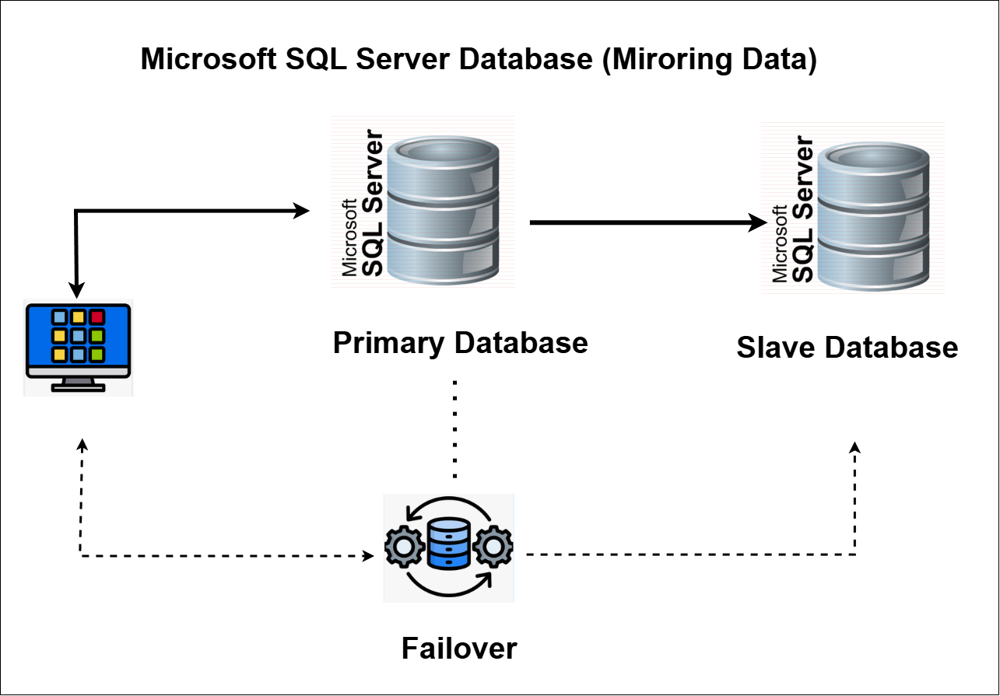

### 2.2 Alur Komunikasi dan Failover Otomatis/Manual
1. **Alur Transaksi Normal**:
   - Aplikasi klien (*Client Computer*) mengarahkan koneksi ke **Primary Database (Port 1433)**.
   - Setiap transaksi data (*INSERT, UPDATE, DELETE*) dicatat dalam *transaction log*.
   - Principal Server mengirimkan aliran *transaction log* melalui *dedicated TCP endpoint* (misal port 5022) ke Mirror Server (port 5023).
   - **Slave Database (Port 1434)** secara terus-menerus mengaplikasikan log tersebut ke basis data pencerminan.
2. **Mekanisme Failover**:
   - Apabila Principal Server mengalami kegagalan (*server crash, network partitioning, maintenance*), sistem *failover* diaktifkan.
   - Pada **Manual Failover** (tanpa Witness), administrator mengeksekusi perintah *failover* dari SSMS atau T-SQL.
   - Slave Database segera keluar dari status `RESTORING`, menyelesaikan transaksi aktif, dan beralih peran menjadi **Principal Database** baru.
   - Aplikasi klien yang dikonfigurasi dengan parameter `Failover Partner` pada *connection string* akan secara otomatis mengarahkan koneksi ke server baru tanpa intervensi kode aplikasi.

---

## 3. Prasyarat & Lingkungan Pengujian

### 3.1 Spesifikasi Server & Port Jaringan
Dalam skenario implementasi ini, pengujian dilakukan pada lingkungan lokal menggunakan multi-instance Microsoft SQL Server:

| Komponen | Sisi Principal (Primary) | Sisi Mirror (Slave) |
| :--- | :--- | :--- |
| **Instance Name** | `MSSQLSERVERMST` / `Localhost,1433` | `Localhost,1434` |
| **Versi SQL Server** | SQL Server 17.0.1155.3 | SQL Server 17.0.1155.3 |
| **Port Service SQL** | `1433` | `1434` |
| **Port Endpoint Mirroring** | `5022` | `5023` |
| **Nama Endpoint** | `Mirroring` | `Mirroring` |
| **Direktori Data** | Direktori default SQL Server | `D:\restore-db-sql-server\` (Relocated) |
| **Direktori Backup** | `D:\backup-db-sql-server\` | `D:\backup-db-sql-server\` |
| **Direktori Snapshot** | - | `D:\snapshoot\` |

### 3.2 Ketentuan Database & Recovery Model
- **Full Recovery Model**: Basis data yang akan di-mirror wajib menggunakan *Recovery Model = FULL*. Model *Simple* atau *Bulk-Logged* tidak didukung.
- **Inisialisasi Identik**: Basis data di sisi Mirror harus di-*restore* dari *Full Backup* dan *Log Backup* terakhir dari Principal menggunakan opsi `WITH NORECOVERY`.
- **Kesesuaian Nama Basis Data**: Nama basis data pada Principal dan Mirror harus persis sama (`db_1`, `db_conto_dari_master`, `LatihanDB`).

---

## 4. Langkah-Langkah Konfigurasi Teknis & Bukti Implementasi

Bagian ini mendokumentasikan tahapan konfigurasi teknis secara berurutan sesuai bukti tangkapan layar visual (*screenshot evidence*).

### 4.1 Tahap 1: Persiapan dan Backup Database di Server Principal

#### Langkah 1: Pemeriksaan Daftar Basis Data di Principal
Pemeriksaan dilakukan pada instance Principal (`Localhost,1433`). Terlihat basis data yang akan dikonfigurasi untuk pencerminan data: `db_1`, `db_conto_dari_master`, dan `LatihanDB`.

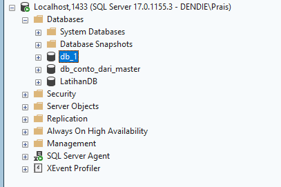

#### Langkah 2: Memulai Operasi Backup Database
Klik kanan pada basis data target (`db_1`) > **Tasks** > **Back Up...**.

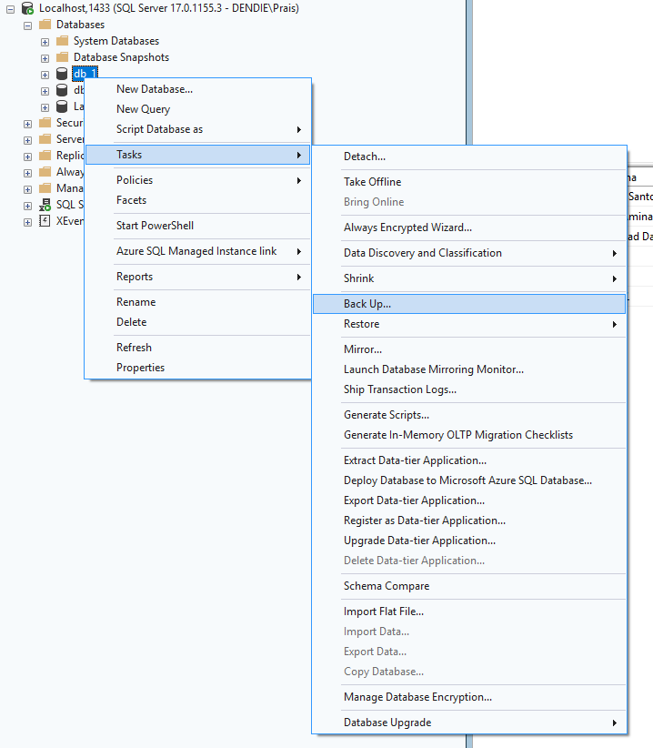

#### Langkah 3: Konfigurasi Full Backup
Pastikan opsi berikut terpilih:
- **Backup type**: `Full`
- **Recovery model**: `FULL`
- **Destination**: Arahkan ke file penyimpanan lokal, contoh: `D:\backup-db-sql-server\db_1.bak`.

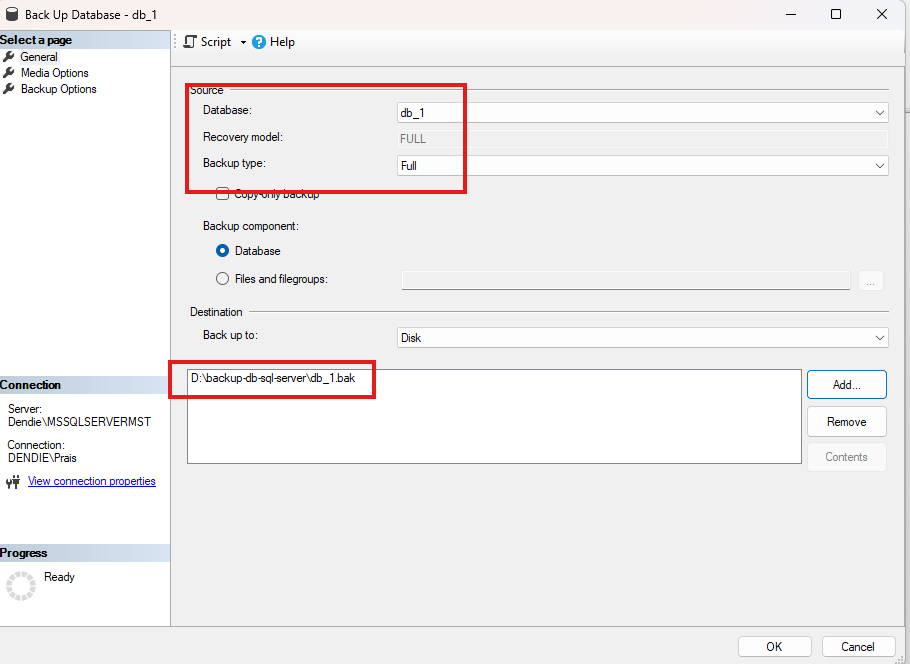

> [!IMPORTANT]
> Lakukan juga **Transaction Log Backup** jika setelah Full Backup terdapat transaksi berjalan, agar rantai LSN (*Log Sequence Number*) antara Principal dan Mirror sinkron sempurna.

#### Langkah 4: Verifikasi File Backup Hasil Ekspor
Pastikan file cadangan (`.bak`) untuk seluruh basis data target telah terbentuk secara utuh di folder penyimpanan:
- `db_1.bak`
- `db_conto_dari_master.bak`
- `LatihaDB.bak`

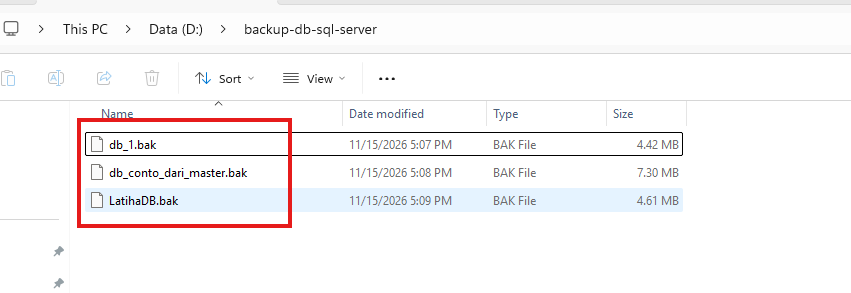

---

### 4.2 Tahap 2: Restore Database di Server Mirror dengan Status NORECOVERY

#### Langkah 5: Membuka Menu Restore pada Instance Mirror (Port 1434)
Buka koneksi SQL Server Management Studio ke server Slave (`Localhost,1434`), klik kanan pada folder **Databases** > **Restore Database...**.

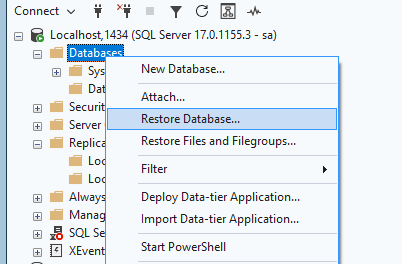

#### Langkah 6: Pemilihan Sumber Cadangan (Backup Device)
Pilih radio button **Device**, lalu klik tombol browse (`...`) dan arahkan ke direktori file cadangan `D:\backup-db-sql-server\`.

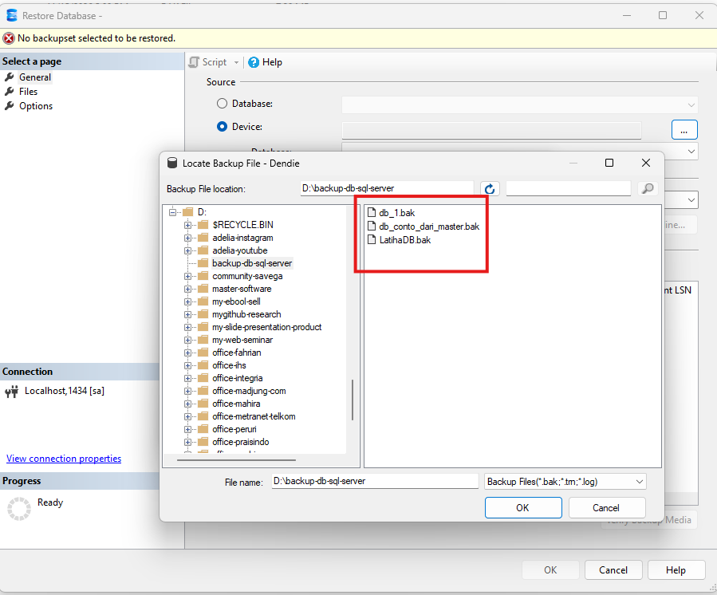

#### Langkah 7: Pengaturan Nama Basis Data Tujuan
Pilih file cadangan `db_1.bak` dan tentukan nama basis data tujuan pada kolom **Database** dengan nama yang identik (`db_1`).

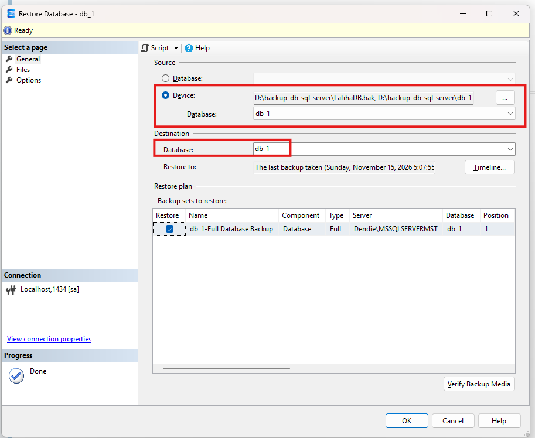

#### Langkah 8: Relokasi File Fisik Database (MDF & LDF)
Masuk ke tab **Files**:
- Centang opsi **Relocate all files to folder**.
- Tentukan direktori penyimpanan baru pada **Data file folder**, misalnya `D:\restore-db-sql-server\`.
- Langkah ini krusial saat kedua instance berjalan pada mesin fisik yang sama (*localhost*) agar tidak terjadi konflik penguncian file fisik dengan instance Principal.

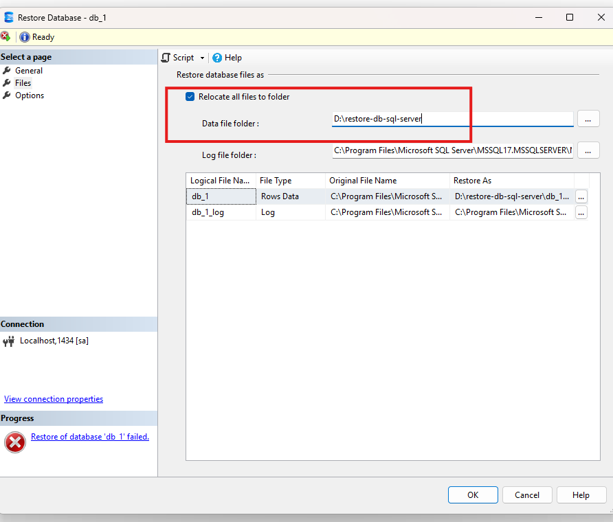

#### Langkah 9: Pemilihan Recovery State (NORECOVERY)
Masuk ke tab **Options**:
- Centang opsi **Overwrite the existing database (WITH REPLACE)**.
- Atur **Recovery state** ke **RESTORE WITH NORECOVERY**. Opsi ini memastikan basis data tetap terbuka untuk menerima aliran *transaction log* tambahan dan belum memasuki fase pemulihan (*ready state*).

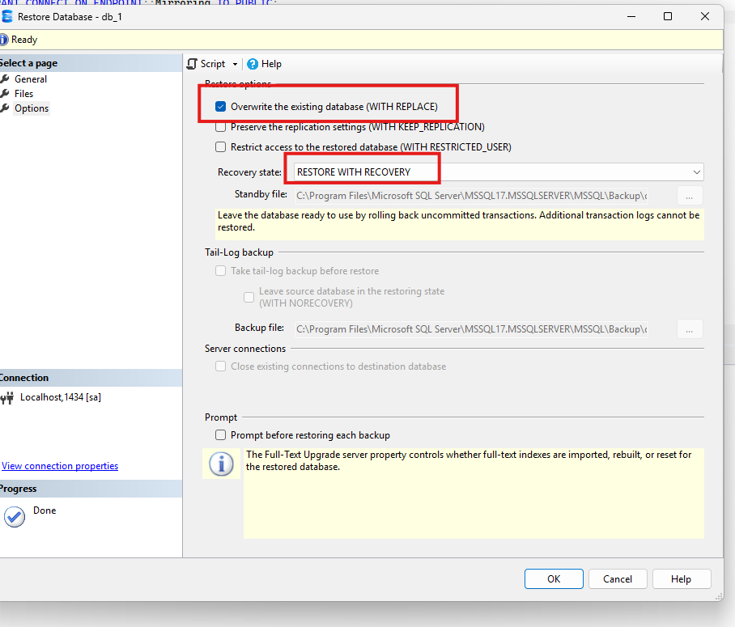

#### Langkah 10: Notifikasi Keberhasilan Restore
Setelah proses selesai, sistem menampilkan dialog konfirmasi bahwa basis data berhasil di-*restore*.

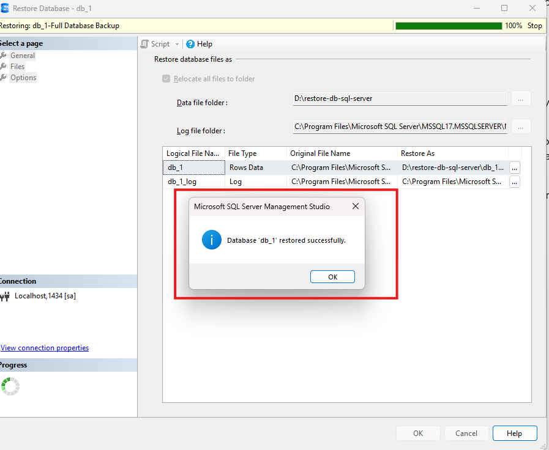

#### Langkah 11: Verifikasi Status Basis Data (Restoring...)
Pada Object Explorer instance `Localhost,1434`, periksa bahwa seluruh basis data yang di-*restore* berstatus `(Restoring...)`. Ini menandakan basis data siap dijadikan partner pencerminan (*mirror partner*).

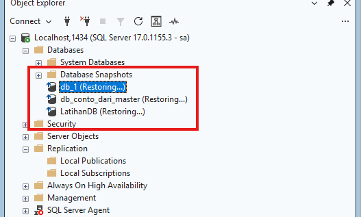

#### Langkah 12: Analisis Perbedaan Struktur File MDF dan LDF
Struktur fisik basis data SQL Server terdiri atas dua komponen utama:
1. **Primary Data File (`.mdf`)**: Menyimpan skema, tabel, indeks, dan data aktual.
2. **Transaction Log File (`.ldf`)**: Menyimpan seluruh riwayat log transaksi untuk menjamin *ACID compliance* dan transmisi mirroring.

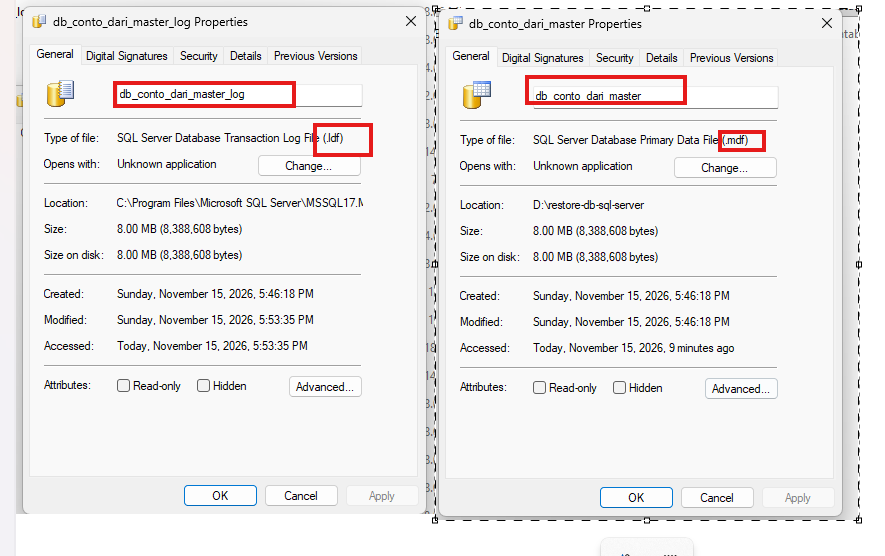

Daftar file fisik yang telah ter-relokasi pada folder `D:\restore-db-sql-server`:
- `db_1.mdf` & `db_1_log.ldf`
- `db_conto_dari_master.mdf` & `db_conto_dari_master_log.ldf`
- `LatihanDB.mdf` & `LatihanDB_log.ldf`

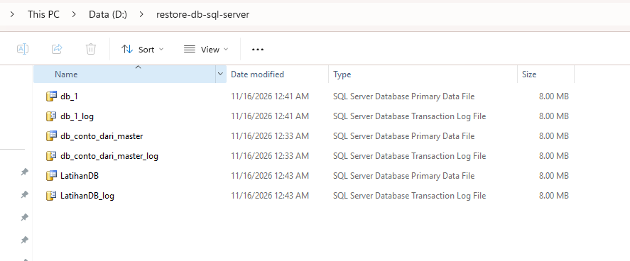

---

### 4.3 Tahap 3: Konfigurasi Endpoint dan Keamanan Mirroring

#### Langkah 13: Membuka Wizard Mirroring di Principal Server
Kembali ke instance Principal (`Localhost,1433`), klik kanan pada basis data target (`db_1`) > **Tasks** > **Mirror...**.

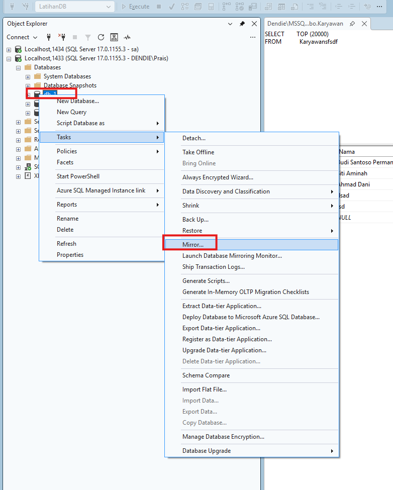

#### Langkah 14: Memulai Security Configuration Wizard
Pada halaman properti **Mirroring**, klik tombol **Configure Security...** untuk membuka wizard konfigurasi keamanan.

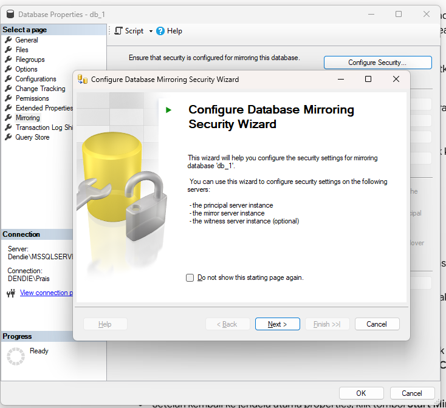

#### Langkah 15: Penentuan Witness Server
Pada langkah **Include Witness Server**, pilih:
- **No**: Untuk mode 2-server (*High Safety without automatic failover* atau *High Performance*).
- **Yes**: Hanya jika tersedia server ketiga yang bertindak sebagai pemantau otomatis (*Witness*).

Pada implementasi ini dipilih **No**.

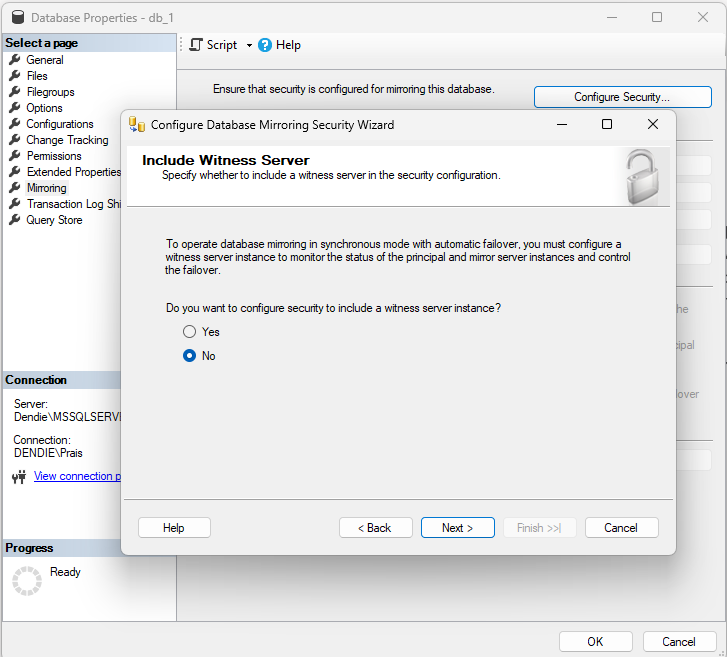

#### Langkah 16: Konfigurasi Endpoint di Sisi Principal
Konfigurasikan properti endpoint untuk Principal Server:
- **Principal server instance**: `Localhost,1433`
- **Listener port**: `5022`
- **Endpoint name**: `Mirroring`
- Centang opsi **Encrypt data sent through this endpoint** untuk menjamin keamanan transmisi log.

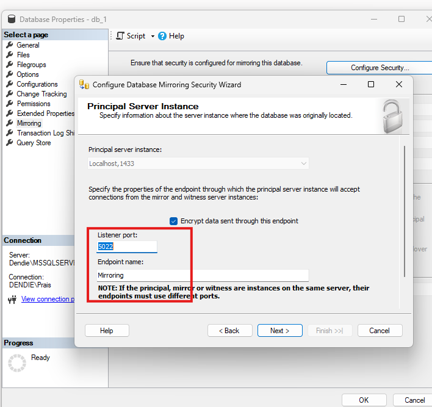

#### Langkah 17: Konfigurasi Endpoint di Sisi Mirror
Konfigurasikan properti endpoint untuk Mirror Server:
- Klik tombol **Connect...** dan autentikasi ke instance `localhost,1434`.
- **Listener port**: `5023` (port wajib berbeda jika berada pada satu host).
- **Endpoint name**: `Mirroring`.

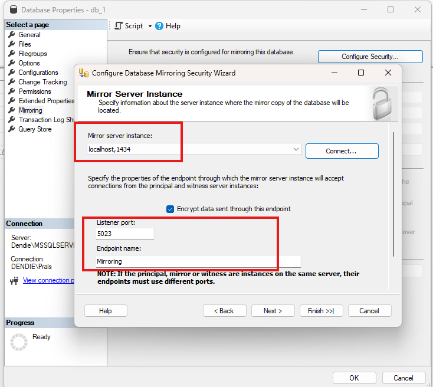

#### Langkah 18: Ringkasan Tindakan Pembuatan Endpoint
Periksa kembali konfigurasi akhir pembuatan endpoint pada kedua server sebelum eksekusi dilakukan.

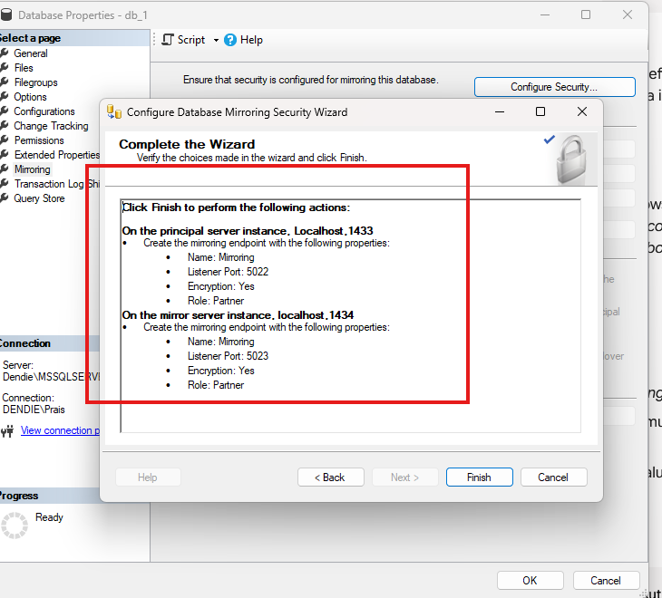

#### Langkah 19: Hasil Pembentukan Endpoint Sukses
Wizard berhasil membuat dan mengaktifkan endpoint mirroring pada kedua instance tanpa galat:
- `Configuring endpoint on principal server (Localhost,1433)`: **Success**
- `Configuring endpoint on mirror server (localhost,1434)`: **Success**

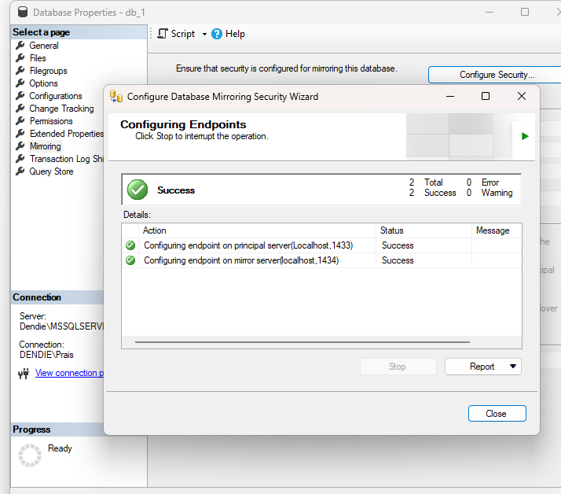

---

### 4.4 Tahap 4: Inisialisasi Mirroring dan Verifikasi Status Sinkronisasi

#### Langkah 20: Menginisialisasi Database Mirroring (Start Mirroring)
Pada jendela utama properti basis data:
- Alamat jaringan server terisi otomatis:
  - **Principal**: `TCP://Dendie:5022`
  - **Mirror**: `TCP://Dendie:5023`
- **Operating mode**: `High safety without automatic failover (synchronous)`.
- Klik tombol **Start Mirroring**.

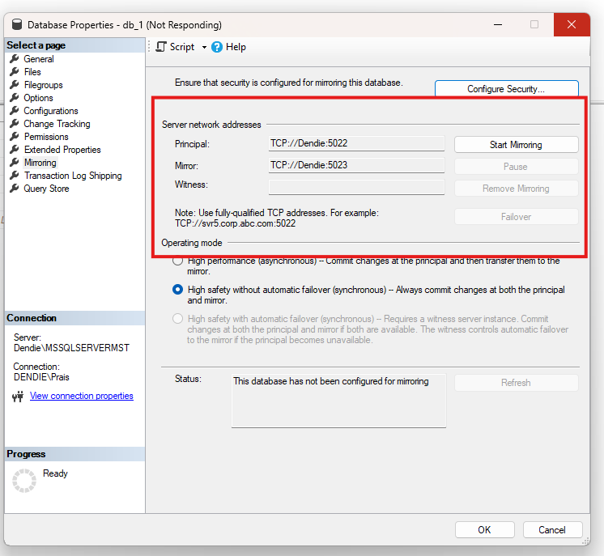

#### Langkah 21: Verifikasi Status Berjalan pada Object Explorer
Setelah mirroring aktif, amati perubahan status pada Object Explorer di kedua instance:
- **Instance `Localhost,1433` (Principal)**:
  - `db_1 (Principal, Synchronized)`
  - `db_conto_dari_master (Principal, Synchronized)`
  - `LatihanDB (Principal, Synchronized)`
- **Instance `Localhost,1434` (Slave/Mirror)**:
  - `db_1 (Mirror, Synchronized / Restoring...)`
  - `db_conto_dari_master (Mirror, Synchronized / Restoring...)`
  - `LatihanDB (Mirror, Synchronized / Restoring...)`

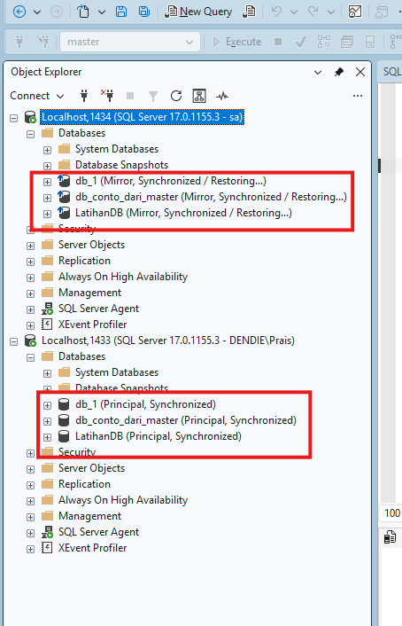

#### Langkah 22: Pengenalan Tombol Operasional Mirroring
Pada jendela properti Mirroring yang telah aktif, terdapat kontrol operasional:
- **Pause**: Menjeda sementara pengiriman transaction log (berguna saat perbaikan jaringan singkat).
- **Remove Mirroring**: Menghapus sesi mirroring secara permanen.
- **Failover**: Memindahkan peran Principal ke Mirror secara manual.
- **Status**: `Synchronized: the databases are fully synchronized`.

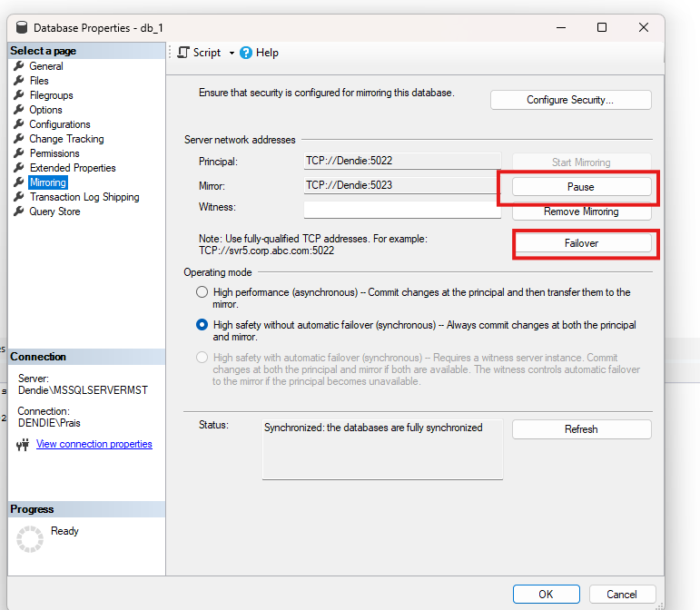

---

### 4.5 Tahap 5: Verifikasi Integritas Data Menggunakan Database Snapshot

Basis data di sisi Mirror berada dalam status `(Mirror, Synchronized / Restoring...)`, sehingga tidak dapat dibuka langsung untuk kueri baca (*read query*). Untuk menguji apakah data dari Principal benar-benar telah tersinkronisasi ke Mirror tanpa harus melakukan *failover*, dibuatlah **Database Snapshot**.

#### Langkah 23: Pembuatan Database Snapshot di Sisi Mirror
Jalankan skrip T-SQL berikut pada instance Slave (`Localhost,1434`):

```sql
CREATE DATABASE LatihanDB_snapshot
ON (
    NAME = LatihanDB,
    FILENAME = 'D:\snapshoot\LatihanDB_snap.ss'
)
AS SNAPSHOT OF LatihanDB;
GO
```

Perintah berhasil dijalankan dan basis data `LatihanDB_snapshot (Read-Only)` muncul di bawah folder **Database Snapshots**.

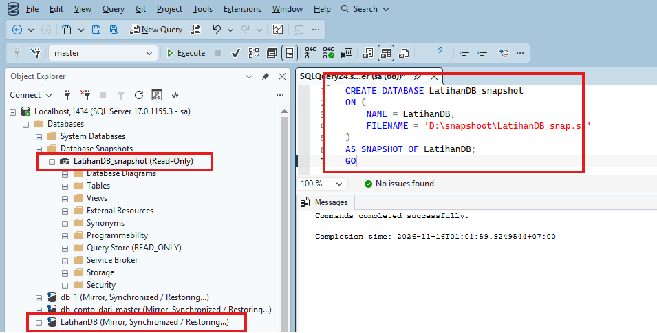

#### Langkah 24: Verifikasi Isi Data Tabel Melalui Snapshot
Lakukan kueri data pada snapshot `LatihanDB_snapshot`:
```sql
SELECT * FROM LatihanDB_snapshot.dbo.Karyawan;
```
Data karyawan (`Budi Santoso`, `Siti Aminah`, `Ahmad Dani`, dll.) tampil secara lengkap dan valid. Hal ini membuktikan bahwa mekanisme sinkronisasi data dari Principal ke Mirror berjalan sempurna.

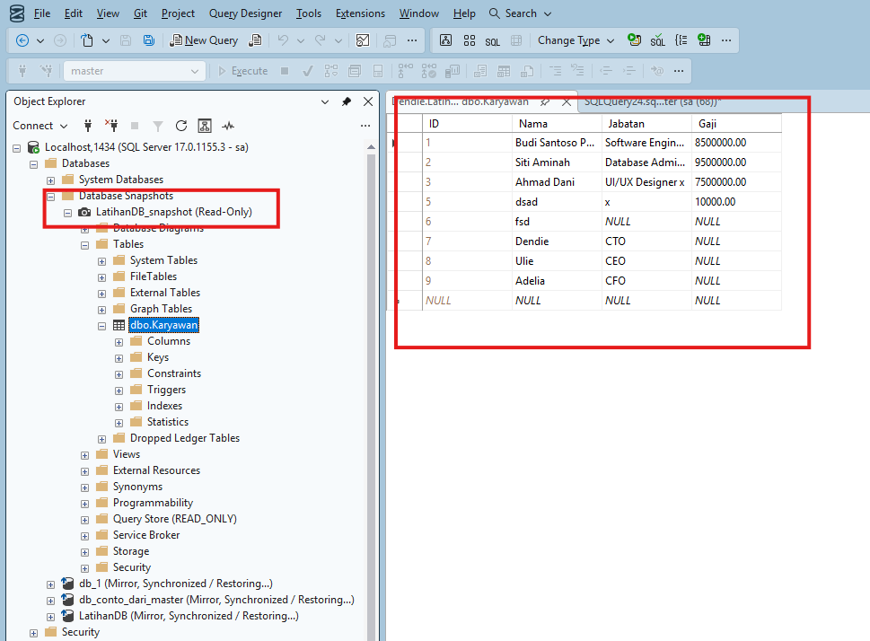

---

### 4.6 Tahap 6: Pengujian Failover (Manual Failover Test)

#### Langkah 25: Eksekusi Failover Manual
Pada jendela Database Properties basis data `LatihanDB` di sisi Principal, klik tombol **Failover**.
- Sebelum failover: Principal = `TCP://Dendie:5022`, Mirror = `TCP://Dendie:5023`.
- Setelah failover: Peran bertukar secara instan: Principal = `TCP://Dendie:5023`, Mirror = `TCP://Dendie:5022`.

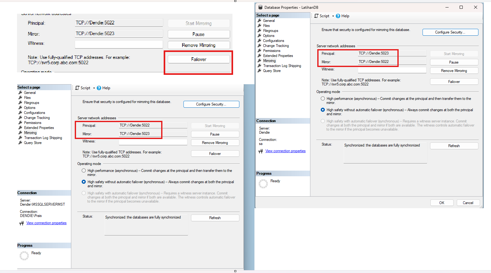

#### Langkah 26: Hasil Pertukaran Peran pada Object Explorer
Amati perubahan peran basis data pada Object Explorer:
- Pada `Localhost,1434` (sebelumnya Slave): basis data `LatihanDB` kini berstatus `(Principal, Synchronized)`.
- Pada `Localhost,1433` (sebelumnya Master): basis data `LatihanDB` kini berstatus `(Mirror, Synchronized / Restoring...)`.
- Basis data lainnya (`db_1` dan `db_conto_dari_master`) tetap berada pada peran semula. Bukti ini menegaskan bahwa Database Mirroring bekerja independen per basis data (*database-level high availability*).

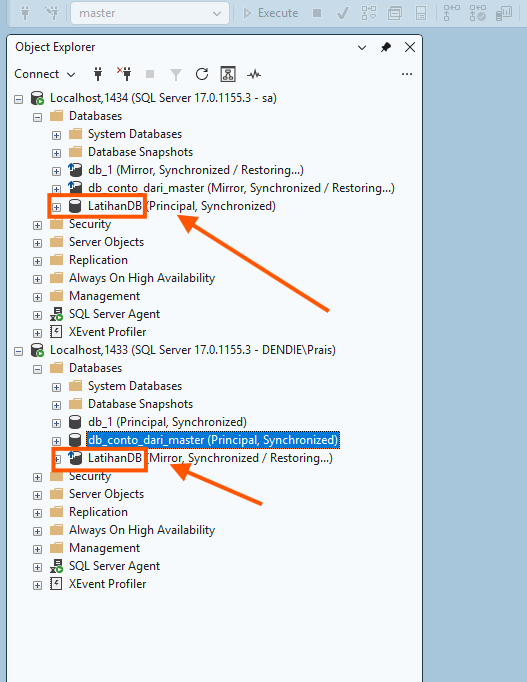

---

## 5. Panduan Pemecahan Masalah (Troubleshooting)

Selama pengoperasian dan konfigurasi Database Mirroring, beberapa kendala teknis dapat terjadi. Berikut adalah panduan pemecahan masalah beserta skrip solusinya:

### 5.1 Penanganan Port Endpoint Tidak Listening atau Terjadi Konflik
Jika endpoint tidak merespons atau terjadi konflik pada port 5023:

```sql
USE master;
GO

-- 1. Hapus endpoint lama jika ada konflik konfigurasi
IF EXISTS (SELECT * FROM sys.database_mirroring_endpoints WHERE name = 'Mirroring')
    DROP ENDPOINT Mirroring;
GO

-- 2. Buat ulang endpoint khusus port 5023
CREATE ENDPOINT Mirroring
    STATE = STARTED
    AS TCP (LISTENER_PORT = 5023)
    FOR DATABASE_MIRRORING (
        ROLE = PARTNER,
        AUTHENTICATION = WINDOWS NEGOTIATE
    );
GO
```

Lakukan uji konektivitas port melalui PowerShell:
```powershell
Test-NetConnection localhost -Port 5023
```
Pastikan keluaran menghasilkan `TcpTestSucceeded : True`.

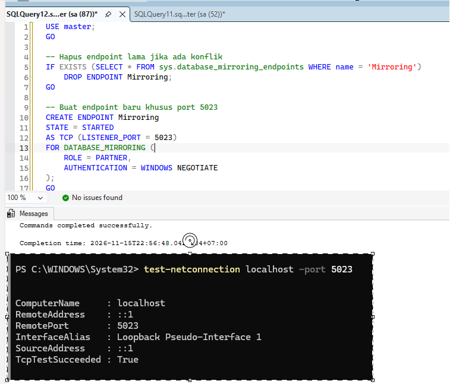

---

### 5.2 Mengatasi Database Terkunci di Sisi Mirror (Drop & Restore Ulang)
Jika konfigurasi mirroring gagal dan basis data di sisi Slave terkunci (*in-use / restoring state*) sehingga tidak bisa dihapus melalui GUI SSMS:

1. Putuskan hubungan partner mirroring terlebih dahulu pada instance port 1434:
   ```sql
   USE master;
   ALTER DATABASE db_1 SET PARTNER OFF;
   ```
2. Hapus basis data yang bermasalah:
   ```sql
   DROP DATABASE db_1;
   ```
3. Lakukan restore ulang file backup `db_1.bak` dengan opsi `RESTORE WITH NORECOVERY`.

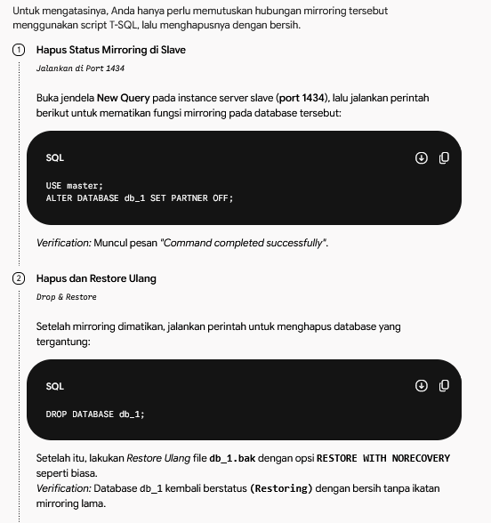

---

### 5.3 Pemberian Hak Akses (Grant Connect) pada Service Account SQL Server
Jika koneksi endpoint gagal karena masalah autentikasi Windows antar service account SQL Server:

1. Jalankan perintah berikut pada **Server Principal (Port 1433)**:
   ```sql
   USE master;
   GO
   -- Memberikan izin connect endpoint ke public / service account
   GRANT CONNECT ON ENDPOINT::Mirroring TO PUBLIC;
   GO
   ```
2. Jalankan perintah yang sama pada **Server Mirror (Port 1434)**:
   ```sql
   USE master;
   GO
   GRANT CONNECT ON ENDPOINT::Mirroring TO PUBLIC;
   GO
   ```

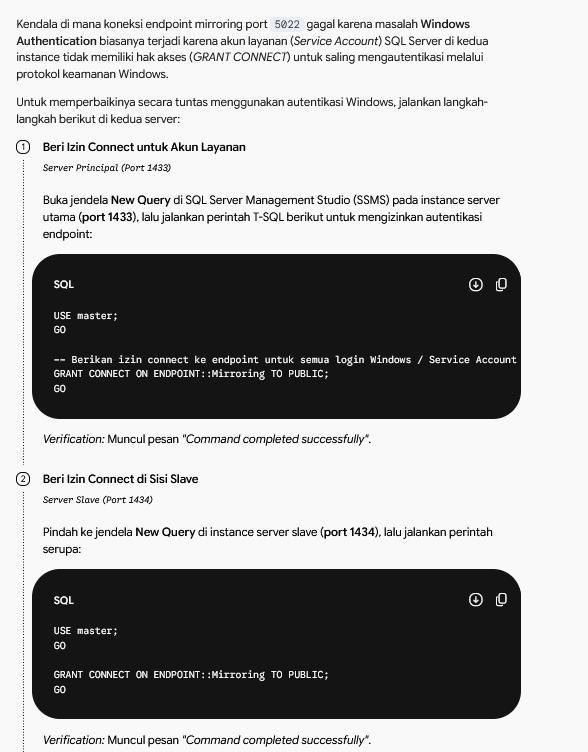

---

### 5.4 Mengatasi Error 1418 (Host Endpoint Unreachable / Registrasi Dua Arah)
Pesan galat **Error 1418** (*"The server network address 'TCP://Dendie:5023' can not be reached or does not exist"*) sering terjadi saat memulai sesi mirroring. Penyebab utamanya adalah endpoint belum siap menerima koneksi masuk (*inbound connection*) atau nama host belum selaras di kedua sisi.

Solusi penyelarasan endpoint dua arah:

1. Buka kueri pada **Server Mirror (Port 1434)**:
   ```sql
   ALTER ENDPOINT Mirroring
   STATE = STARTED
   AS TCP (LISTENER_PORT = 5023)
   FOR DATABASE_MIRRORING (
       ROLE = PARTNER,
       AUTHENTICATION = WINDOWS NEGOTIATE
   );
   ```
2. Buka kueri pada **Server Principal (Port 1433)**:
   ```sql
   ALTER ENDPOINT Mirroring
   STATE = STARTED
   AS TCP (LISTENER_PORT = 5022)
   FOR DATABASE_MIRRORING (
       ROLE = PARTNER,
       AUTHENTICATION = WINDOWS NEGOTIATE
   );
   ```

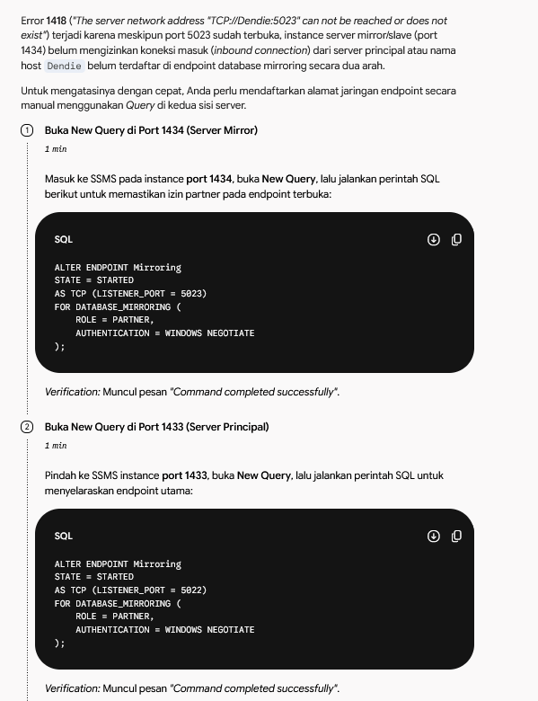

---

## 6. Kesimpulan dan Best Practices

1. **Efektivitas Ketersediaan Tinggi**: Database Mirroring merupakan solusi yang andal untuk perlindungan data per basis data tanpa memerlukan investasi perangkat keras *shared storage*.
2. **Koneksi Transparan Klien**: Aplikasi dapat melakukan failover otomatis tanpa perubahan konfigurasi manual apabila menyertakan parameter `Failover Partner` pada *connection string*:
   ```
   Server=Dendie,1433;Failover Partner=Dendie,1434;Database=LatihanDB;User Id=sa;Password=YourPassword;
   ```
3. **Pemanfaatan Database Snapshot**: Untuk kebutuhan pelaporan (*read-only reporting / ETL extraction*) tanpa membebani server utama, administrator dapat membuat snapshot berkala pada server Mirror.
4. **Strategi Pemeliharaan Berkala**: Lakukan perawatan rutin pada *transaction log* (log backup berkala) agar ukuran file LDF tetap terkendali dan tidak memenuhi kapasitas disk penyimpanan.

